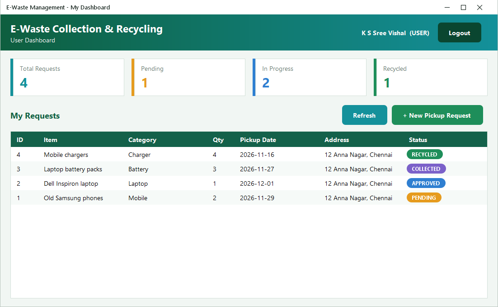
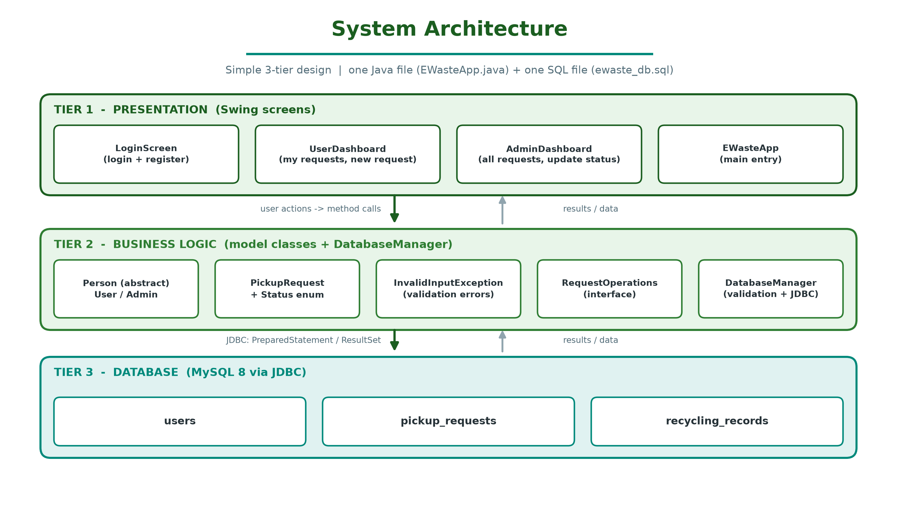
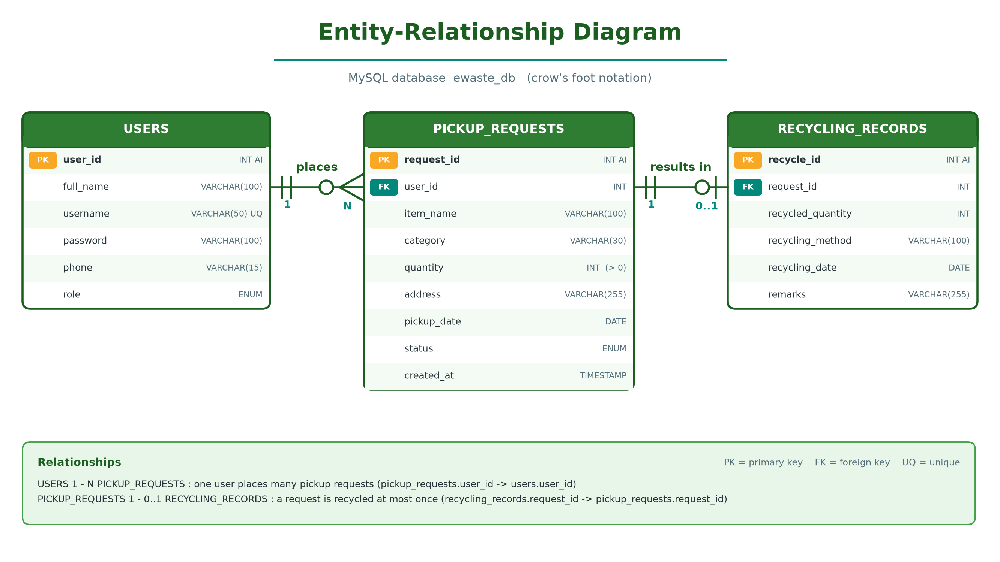
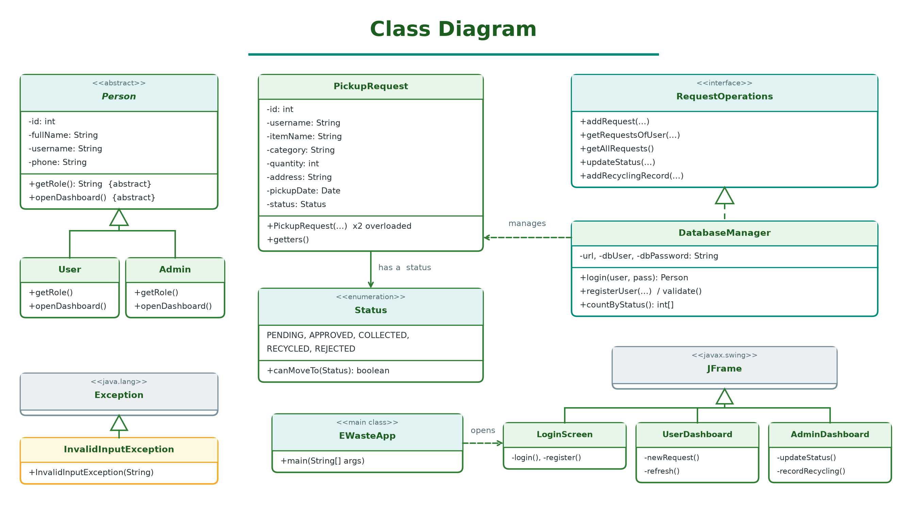
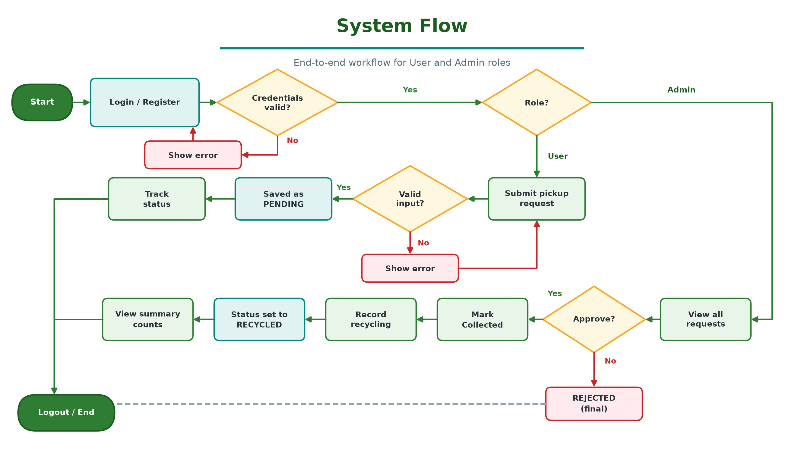

# E-Waste Collection & Recycling Management System

Java Swing + MySQL (JDBC) desktop application — **IT19341 Introduction to OOPS and Java** project,
B.Tech Information Technology, Rajalakshmi Engineering College, Chennai.

**Team:** Deveshwar (251001048) · K S Sree Vishal (251001264) · Vijay Karthik S (251001301) · Srihari S (251001268)



Users register and raise e-waste pickup requests; the administrator approves, collects and records recycling.
Every request follows a strict lifecycle enforced by the `Status` enum:
`PENDING → APPROVED → COLLECTED → RECYCLED` (or `REJECTED`).

## Project files
| File | What it is |
|------|------------|
| `EWasteApp.java` | All Java code (model classes, JDBC database layer, Swing screens) |
| `ewaste_db.sql` | All database code (schema, sample data, sample queries) |
| `run.bat` | Compiles and starts the app |
| `lib/` | MySQL Connector/J 9.1.0 and FlatLaf 3.5.4 (UI theme) jars |
| `docs/` | Presentation (PPTX/PDF), project report (DOCX/PDF), presentation script, diagrams, screenshots |

## Requirements
JDK 17+, MySQL 8, Windows (for `run.bat`; on other OSes use `:` instead of `;` in the classpath).

## Setup & run
1. Create the app's MySQL user (once, as root):
   ```sql
   CREATE USER IF NOT EXISTS 'ewaste'@'localhost' IDENTIFIED BY 'ewaste123';
   GRANT ALL PRIVILEGES ON ewaste_db.* TO 'ewaste'@'localhost';
   FLUSH PRIVILEGES;
   ```
2. Load the database (re-run any time to reset demo data):
   `mysql -uewaste -pewaste123 < ewaste_db.sql`
3. Start: `run.bat`
   (or `javac -cp ".;lib\*" EWasteApp.java` then `java -cp ".;lib\*" EWasteApp`)

DB connection constants are at the top of class `DatabaseManager` in `EWasteApp.java`.

## Demo logins
| Role | Username | Password |
|------|----------|----------|
| Admin | admin | admin123 |
| User | vishal | vishal123 |
| User | deveshwar | dev123 |

## OOP concepts applied
| Concept | Where |
|---------|-------|
| Class & object | `Person`, `User`, `Admin`, `PickupRequest` |
| Encapsulation | private fields + getters; DB credentials private in `DatabaseManager` |
| Inheritance | `Person → User/Admin`, screens `extends JFrame`, `InvalidInputException extends Exception` |
| Polymorphism | `login()` returns a `Person`; `person.openDashboard()` runs the User or Admin version; overloaded constructors/helpers |
| Abstraction | abstract class `Person`, interface `RequestOperations` |
| Exception handling | custom `InvalidInputException`, try-with-resources for JDBC |
| Enum with behaviour | `Status.canMoveTo()` enforces the request lifecycle |

## Diagrams
| Architecture | ER diagram |
|---|---|
|  |  |
| **Class diagram** | **System flow** |
|  |  |

## Limitations / future work
Passwords are stored as plain text (academic demo) — future: salted hashing. Also planned: email/SMS notifications,
pickup staff assignment, reports & charts, web/Android version.
